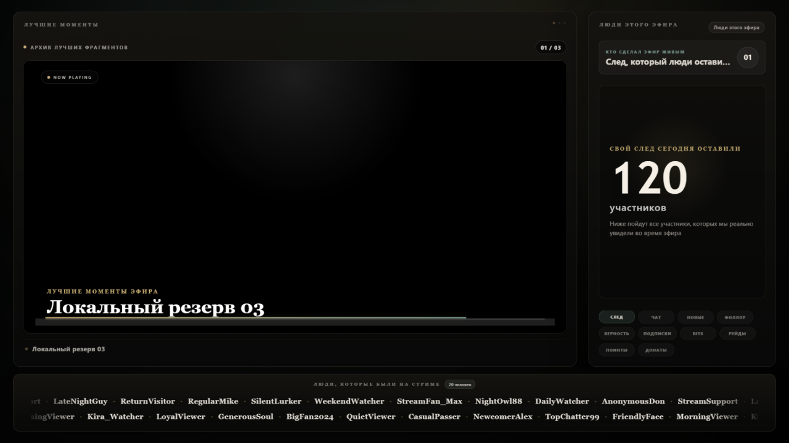
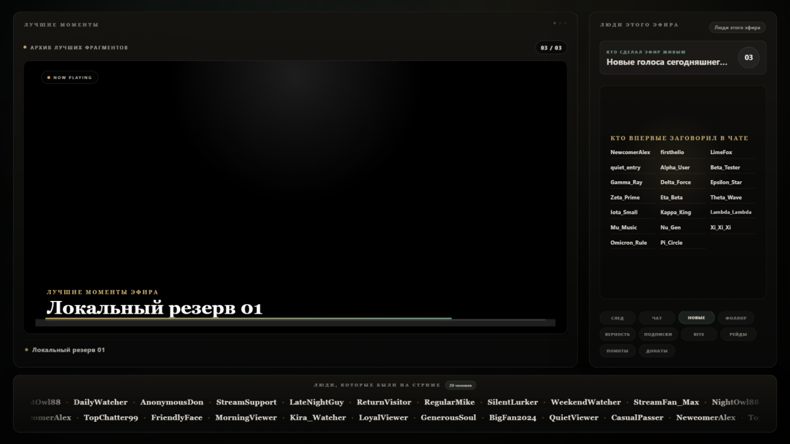

# Ending: финальная сцена для стрима

Красивая концовка эфира для OBS. Когда вы переключаетесь на сцену, она сама:

- показывает титры со **всеми зрителями этого эфира** (ники собираются из чата и списка зрителей);
- выводит топ чаттеров, серии просмотров, новых подписчиков, сабов, битсы, рейды и награды за баллы канала;
- показывает **донаты** за эфир (через DonationAlerts, по желанию);
- проигрывает **клипы** вашего канала, снятые за эфир;
- играет музыку и в конце выводит прощальную надпись;
- **останавливает стрим** в OBS, когда всё закончилось (по желанию).





*На скриншотах демо-режим: ники выдуманные.*

Всё работает на вашем компьютере. Ничего не отправляется на чужие серверы: программа обращается только к Twitch, DonationAlerts и к вашему OBS.

## Что нужно

| | |
|---|---|
| Система | Windows 10 или 11 (скрипты запуска написаны под Windows) |
| Python | 3.10 или новее, скачать на [python.org](https://www.python.org/downloads/) |
| OBS Studio | версия 28 или новее |
| Twitch | ваш канал и аккаунт разработчика (бесплатно, шаг 3) |
| DonationAlerts | по желанию, нужен только для блока донатов |

Чтобы **посмотреть демо**, не нужно ничего, кроме Python: ни Twitch, ни OBS.

## Установка

### 1. Скачайте и распакуйте

Распакуйте архив в обычную папку, например `C:\Ending` или `Документы\Ending`. Не запускайте файлы прямо из окна архива и не кладите папку в `Program Files`: Ending пишет рядом с собой настройки и данные эфиров.

Если Windows при запуске показывает «Защитник Windows предотвратил запуск» или помечает файл: правой кнопкой по скачанному `.zip` → «Свойства» → «Разблокировать» → ОК, и только потом распакуйте.

### 2. Запустите `install.bat`

Дважды щёлкните по `install.bat`. Он сам:

1. создаёт окружение `venv` внутри папки (ничего не ставится в систему);
2. скачивает нужные библиотеки (нужен интернет, 1–2 минуты);
3. создаёт файл настроек `.env`;
4. проверяет, что всё запускается.

Если Python не найден, скрипт так и скажет. Установите Python и **поставьте галочку «Add python.exe to PATH»** в первом окне установщика. Потом запустите `install.bat` ещё раз.

В конце установщик предложит запустить демо. Согласитесь: откроется сцена с тестовыми зрителями и донатами, без всяких ключей. Тот же адрес вручную: <http://127.0.0.1:8080/ending.html?demo=1>

### 3. Подключите Twitch

Это нужно, чтобы сцена видела ваших зрителей и клипы. Делается один раз.

1. Зайдите на <https://dev.twitch.tv/console/apps> под своим аккаунтом. Twitch потребует включить **двухфакторную защиту**: [настройки безопасности](https://www.twitch.tv/settings/security).
2. Нажмите **Register Your Application** и заполните:
   - **Name**: любое уникальное имя, например `MyChannel Ending`;
   - **OAuth Redirect URLs**: `http://localhost:8080/auth/twitch/callback` (точно так, нажмите **Add**);
   - **Category**: любая подходящая, например `Application Integration`.
3. Создайте приложение, откройте **Manage** и скопируйте **Client ID**. Нажмите **New Secret** и скопируйте **Client Secret**. Секрет показывается один раз.
4. Запустите `configure.bat` и введите логин канала, Client ID и Client Secret. (Или откройте `.env` в Блокноте и впишите их в `TWITCH_CLIENT_ID`, `TWITCH_CLIENT_SECRET`, `TWITCH_CHANNEL_LOGIN`.)
5. Запустите Ending: `start-ending.bat`.
6. Откройте в браузере <http://localhost:8080/auth/twitch/login>, войдите **аккаунтом стримера** (или модератора канала) и разрешите доступ.

Увидели «Готово. Twitch авторизация сохранена»: всё подключено. Проверить: <http://localhost:8080/api/twitch/status>.

> Client Secret и токены лежат в `.env`. Никому не отправляйте этот файл и не публикуйте его. Если секрет утёк, нажмите **New Secret** в консоли Twitch: старый перестанет работать.

### 4. Подключите DonationAlerts (по желанию)

Нужно только для блока донатов в титрах.

1. Откройте <https://www.donationalerts.com/application/clients> и создайте приложение.
2. **Redirect URI**: `http://localhost:8080/auth/donationalerts/callback`
3. Запустите `configure.bat`, на вопрос про DonationAlerts ответьте «д» и введите Client ID и Client Secret.
4. Перезапустите Ending и откройте <http://localhost:8080/auth/donationalerts/login>. Разрешите доступ.

### 5. Добавьте сцену в OBS

1. В OBS: **Источники** → **+** → **Браузер**.
2. **URL**: `http://localhost:8080/ending.html`
3. **Ширина** `1920`, **Высота** `1080`.
4. Включите (в английском интерфейсе названия указаны в скобках):
   - «Выключать источник, когда он не отображается» (Shutdown source when not visible);
   - «Обновлять браузер, когда сцена становится активной» (Refresh browser when scene becomes active);
   - «Управлять звуком через OBS» (Control audio via OBS): тогда музыка идёт в микшер OBS и попадает в эфир и запись.
5. Поместите источник на отдельную сцену, например «Финал».

**Автоостановка стрима** (по желанию). В конце сцена может сама остановить трансляцию:

1. В OBS: меню **Инструменты** (Tools) → **WebSocket Server Settings** (в русском интерфейсе название может чуть отличаться) → включите сервер, включите аутентификацию, задайте пароль. Порт оставьте `4455`.
2. Впишите этот пароль: `configure.bat`, вопрос про OBS (или `OBS_WS_PASSWORD` в `.env`).

Если не хотите, чтобы сцена сама останавливала стрим, поставьте `"auto_stop_stream": false` в блоке `show` файла `mock-ending-state.json`.

### 6. Положите музыку

Музыка в комплект **не входит**: права на чужие треки раздавать нельзя. Положите свой трек в папку `assets` под именем `ending-track.mp3`. Длительность трека задаёт длительность всей сцены. Подробности в `assets\README.txt`.

Без трека сцена тоже работает, но молча и по запасному таймеру в 3 минуты.

Используйте музыку, которую вам разрешено транслировать. Twitch может заглушить записи эфиров с чужими треками.

## Каждый день

Главное правило: **Ending должен работать весь эфир**. Ники зрителей, сообщения и события он собирает, пока идёт стрим. Если во время эфира он был выключен, титры будут пустыми: Twitch не отдаёт список зрителей задним числом.

Способы запуска:

| Способ | Как |
|---|---|
| Вручную, в окне | `start-ending.bat`. Закрыли окно: остановился |
| В фоне, без окна | `start-ending-hidden.vbs`. Остановить: `stop-ending.bat` |
| Вместе с OBS | запускайте OBS через `start-obs-with-ending.vbs` (можно сделать ярлык) или добавьте в OBS скрипт `obs-start-ending.lua` через **Инструменты → Скрипты** |
| Вместе с Windows | PowerShell в папке Ending: `powershell -ExecutionPolicy Bypass -File .\install-ending-autostart.ps1`. Убрать: `uninstall-ending-autostart.ps1`. Если PowerShell пишет «Отказано в доступе», запустите его от имени администратора |

Проверить, что Ending жив: `status-ending.vbs` или <http://127.0.0.1:8080/ending-status.html>.

В конце эфира переключитесь в OBS на сцену «Финал».

## Какие данные хранятся

Всё лежит в папке Ending на вашем компьютере:

| Что | Где |
|---|---|
| Ключи и токены | `.env` |
| Ники зрителей, сообщения (счётчики), события эфиров | `data\session-store.sqlite3` |
| Скачанные клипы | `assets\clip-cache` (со временем занимает гигабайты) |
| Журнал работы | `data\ending-backend.log` |

Чтобы стереть историю эфиров, остановите Ending и удалите `data\session-store.sqlite3`. Кэш клипов можно удалять в любой момент, он наполнится снова.

**Не публикуйте и не отправляйте** `.env` и папку `data`: в них ключи и ники ваших зрителей.

## Если что-то не работает

**`install.bat` пишет «Не найден Python».** Установите Python с [python.org](https://www.python.org/downloads/) с галочкой «Add python.exe to PATH», запустите `install.bat` снова. Если Python стоит, а скрипт его не видит, откройте «Параметры → Приложения → Псевдонимы выполнения приложений» и отключите «python.exe» и «python3.exe» от Microsoft Store.

**Установка прервалась на скачивании библиотек.** Проверьте интернет, отключите VPN/прокси и запустите `install.bat` ещё раз. Он безопасно повторяется.

**Страница не открывается или порт занят.** Ending использует порт 8080. Если его занимает другая программа, фоновый запуск молча не стартует: смотрите `data\ending-backend.log`. Освободите порт 8080. Менять порт можно, но тогда нужно поменять адрес и в OBS, и Redirect URL у приложений Twitch/DonationAlerts, и `TWITCH_REDIRECT_URI` / `DONATIONALERTS_REDIRECT_URI` в `.env`.

**Twitch: «redirect_mismatch».** Redirect URL в консоли Twitch не совпадает с `TWITCH_REDIRECT_URI` в `.env`. Они должны быть одинаковыми до символа: `http://localhost:8080/auth/twitch/callback`.

**Twitch: ошибка про scope или «не хватает прав».** Откройте <http://localhost:8080/api/twitch/status>: там видно, каких прав не хватает. Пройдите вход заново: <http://localhost:8080/auth/twitch/login>.

**Титры пустые.** Ending не работал во время эфира (см. «Каждый день»). Откройте `?demo=1`, чтобы убедиться, что сама сцена в порядке.

**В титрах чужие выдуманные ники (`StreamFan_Max`, `NightOwl88`, `Kira_Watcher`…).** Это демо-данные из `mock-ending-state.json`. Сцена подставляет их, когда не смогла собрать настоящие: Twitch не подключён, ключи неверные или нет данных за эфир. **Проверьте это до первого настоящего финала**: откройте <http://localhost:8080/api/twitch/status> и убедитесь, что там ваш канал и нет ошибок, а в конце тестового эфира `http://localhost:8080/api/ending-state` содержит ваших зрителей.

**Нет клипов.** Клипы берутся с Twitch за время эфира, потом за последние 30 дней, потом за год. Если у канала нет клипов, сцена покажет встроенные заставки.

**Клип в обычном браузере не стартует сам.** Это ограничение браузера (автовоспроизведение со звуком). В OBS клипы играют без кликов.

**Стрим не остановился в конце.** Проверьте, что OBS запущен, WebSocket-сервер включён, а пароль в `.env` совпадает.

**Антивирус ругается на `.vbs`.** Файлы `start-ending-hidden.vbs`, `status-ending.vbs` и `start-obs-with-ending.vbs` только запускают Ending без окна консоли, прочитайте их: это несколько строк. Если антивирус всё равно мешает, используйте `start-ending.bat`.

## Обновление

Распакуйте новую версию в ту же папку с заменой файлов, потом запустите `install.bat`. В архиве нет `.env`, папки `data` и вашей музыки, поэтому ничего из них не затрётся. Если вы правили `mock-ending-state.json` (тему, финальную надпись), сохраните копию перед заменой.

## Удаление

1. Остановите Ending (`stop-ending.bat` или закройте окно).
2. Если включали автозапуск: `uninstall-ending-autostart.ps1`.
3. Удалите папку Ending целиком. Окружение `venv` лежит внутри неё, в системе ничего не остаётся.
4. По желанию отзовите доступ на <https://www.twitch.tv/settings/connections>.

## Для разработчиков

Как всё устроено, откуда берутся данные, все endpoints и формат `ending-state`: [docs/TECHNICAL.md](docs/TECHNICAL.md).

Запуск без `.bat` (в том числе на macOS и Linux; скрипты запуска `.bat`/`.vbs` работают только на Windows):

```bash
python3 setup_ending.py          # установка
venv/bin/python serve.py 8080    # запуск (в Windows: venv\Scripts\python.exe serve.py 8080)
```
