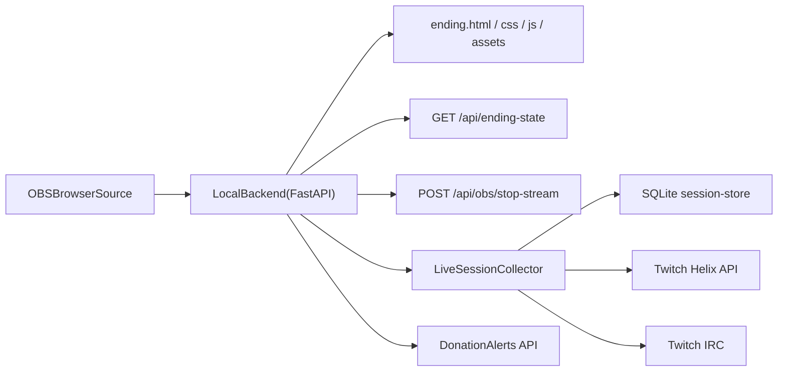

# Stream Ending Scene: техническое описание

> Это документ для тех, кто хочет разобраться, как устроен Ending изнутри.
> Установка и подключение для обычного пользователя описаны в [README.md](../README.md):
> `install.bat` делает шаги «Быстрый старт» ниже автоматически.

Финальная сцена для `OBS Browser Source` с локальным same-origin backend.

Теперь это не просто набор `html/css/js`, а связка из:
- фронта сцены,
- локального backend-а,
- Twitch auth + live collector,
- DonationAlerts auth + donations snapshot,
- snapshot API для финальной сцены,
- `obs-websocket` stop-stream endpoint.

## Что лежит в проекте

| Файл / каталог | Назначение |
|---|---|
| `ending.html` | HTML-сцена для OBS |
| `ending.css` | стили и motion UI |
| `ending.js` | таймлайн, клипы, stats, титры, stop-stream |
| `mock-ending-state.json` | demo/fallback/base-конфиг сцены |
| `serve.py` | запуск локального backend-а |
| `requirements.txt` | Python-зависимости backend-а |
| `.env.example` | пример конфигурации Twitch / DonationAlerts / OBS / collector |
| `backend/` | FastAPI app, Twitch client, DonationAlerts client, collector, SQLite store, state builder |
| `data/session-store.sqlite3` | локальная база сессий и live-данных, создаётся автоматически |

## Что изменилось по архитектуре

Раньше сцена жила отдельно и ждала внешний backend.

Теперь backend встроен прямо в проект:



## Как это работает теперь

### Во время эфира

Backend:
- следит, идёт ли стрим;
- создаёт/ведёт текущую session;
- читает сообщения из Twitch IRC;
- слушает Twitch EventSub для live-событий канала;
- периодически вызывает `Get Chatters`;
- складывает usernames, `message_count` и события эфира в локальную SQLite базу.

### Когда включается финальная сцена

`ending.html` делает:

```txt
GET /api/ending-state
```

Backend собирает snapshot из:
- live-сессии в SQLite,
- Twitch `Get Clips`,
- DonationAlerts donations за окно эфира,
- fallback-конфига из `mock-ending-state.json`.

Фронт получает уже готовый JSON и сам режиссирует финал.

## Что именно берётся из Twitch автоматически

Из Twitch backend умеет брать:
- текущий live stream (`Get Streams`);
- последний archive VOD (`Get Videos`);
- клипы за окно времени эфира (`Get Clips`);
- точную длительность клипа `duration`;
- `embed_url` для Twitch clip;
- попытку прямого playable media URL для `<video>` через `yt-dlp`, чтобы сцена не зависела только от iframe;
- текущих chatters через `Get Chatters`;
- first-time chatters из Twitch IRC tags;
- follows, subs, gift subs, bits, raids и channel points redemptions через Twitch EventSub.

Из DonationAlerts backend умеет брать:
- donations за окно текущего/последнего эфира;
- имя донатора;
- сумму и валюту;
- текст доната;
- количество донатов от одного человека за эфир.

## Что Twitch официально НЕ отдаёт

Twitch API не даёт:
- полный исторический список всех зрителей прошедшего эфира;
- историю VOD-чата post factum;
- “кто просто смотрел, но ни разу не проявился” задним числом.

Поэтому в этой системе:
- `credits` = все usernames, которых collector успел увидеть **во время эфира**;
- `top_chatters` = usernames с наибольшим `message_count` из live chat;
- `total_seen_users` = уникальные usernames, замеченные IRC + `Get Chatters`;
- `top_streaks` = локальная метрика по session history, а не Twitch-native статистика;
- `first_time_chatters`, `follows`, `subscription_events`, `bits_leaders`, `raids`, `reward_redemptions` = только реально пойманные live-события.

А вклад через поддержку берётся отдельно:
- `donors` = агрегированный список донаторов за окно эфира из DonationAlerts, если OAuth настроен.

Это важно: backend не придумывает зрителей и не достаёт магией недоступные данные из Twitch.

## Быстрый старт

### 1. Установить зависимости

```bash
python -m pip install -r requirements.txt
```

### 2. Создать `.env`

Скопируй `.env.example` в `.env` и заполни минимум:

```env
TWITCH_CLIENT_ID=
TWITCH_CLIENT_SECRET=
TWITCH_CHANNEL_LOGIN=
TWITCH_REDIRECT_URI=http://localhost:8080/auth/twitch/callback

DONATIONALERTS_CLIENT_ID=
DONATIONALERTS_CLIENT_SECRET=
DONATIONALERTS_REDIRECT_URI=http://localhost:8080/auth/donationalerts/callback

OBS_WS_URL=ws://127.0.0.1:4455
OBS_WS_PASSWORD=
```

Токены `TWITCH_USER_ACCESS_TOKEN` / `TWITCH_REFRESH_TOKEN` и `DONATIONALERTS_ACCESS_TOKEN` / `DONATIONALERTS_REFRESH_TOKEN` можно не заполнять вручную: они сохранятся после OAuth callback.

`TWITCH_CHANNEL_LOGIN` автоматически исключается из зрительских списков и серий. Дополнительные служебные аккаунты можно добавить через `ENDING_BOT_LOGINS` через запятую.

### 3. Запустить backend

```bash
python serve.py 8080
```

После запуска будут доступны:
- `http://127.0.0.1:8080/ending.html`
- `http://127.0.0.1:8080/ending.html?demo=1`
- `http://127.0.0.1:8080/auth/twitch/login`
- `http://127.0.0.1:8080/auth/donationalerts/login`

### 3.1. Запуск без консоли

Если не хочется держать открытой консольное окно, можно запускать backend скрыто:

```txt
start-ending-hidden.vbs
```

Этот launcher использует `venv\Scripts\pythonw.exe`, пишет лог в `data/ending-backend.log` и не запускает второй backend, если `http://127.0.0.1:8080/api/health` уже отвечает.

Проверить, жив ли backend:

```txt
status-ending.vbs
```

Или открыть страницу:

```txt
http://127.0.0.1:8080/ending-status.html
```

#### Автозапуск вместе с Windows

Один раз запусти из PowerShell в папке проекта:

```powershell
powershell -ExecutionPolicy Bypass -File .\install-ending-autostart.ps1
```

Скрипт создаст задачу `Ending Backend` в Windows Task Scheduler и сразу попробует запустить backend. Удалить автозапуск можно так:

```powershell
powershell -ExecutionPolicy Bypass -File .\uninstall-ending-autostart.ps1
```

#### Запуск вместе с OBS

Самый простой вариант — запускать OBS через обёртку:

```txt
start-obs-with-ending.vbs
```

Она сначала тихо вызывает `start-ending-hidden.vbs`, потом открывает OBS из стандартной папки установки. Можно сделать ярлык на этот файл и пользоваться им вместо обычного ярлыка OBS.

Альтернативный вариант — встроенный скрипт OBS. В OBS открой `Tools` → `Scripts`, нажми `+` и добавь:

```txt
obs-start-ending.lua
```

Когда OBS загрузит этот Lua-скрипт, он вызовет `start-ending-hidden.vbs`. Кнопка `Start Ending now` в настройках скрипта делает то же самое вручную.

### 4. Один раз пройти Twitch auth

Открой:

```txt
http://localhost:8080/auth/twitch/login
```

После успешного callback backend:
- сохранит `TWITCH_USER_ACCESS_TOKEN`,
- сохранит `TWITCH_REFRESH_TOKEN`,
- сохранит `TWITCH_AUTH_LOGIN`,
- сохранит `TWITCH_AUTH_USER_ID`.

### 5. Проверить статус

```txt
GET /api/twitch/status
```

Этот endpoint показывает:
- поднят ли collector,
- найден ли broadcaster,
- есть ли активная session,
- настроены ли app/user credentials.

Для DonationAlerts есть отдельный статус:

```txt
GET /api/donationalerts/status
```

## Как использовать в OBS

1. В OBS добавь `Browser Source`
2. URL:

```txt
http://localhost:8080/ending.html
```

3. Размер:
- Width: `1920`
- Height: `1080`

4. Включи:
- `Shutdown source when not visible`
- `Refresh browser when scene becomes active`

## Demo и query params

| Параметр | Что делает |
|---|---|
| `?demo=1` | сначала просит backend demo-snapshot (`/api/ending-state?demo=1`) с автоклипами из Twitch, и только если backend недоступен, падает в чистый `mock-ending-state.json` |
| `?debug=1` | включает debug overlay |
| `?demo=1&debug=1` | оба режима сразу |

## Роль `mock-ending-state.json`

Этот файл теперь используется в трёх режимах:

1. как base-конфиг для `?demo=1`, поверх которого backend по возможности всё равно подтягивает авто-клипы из Twitch
2. как fallback, если backend не может собрать live snapshot
3. как base-конфиг production-сцены:
   - `audio`
   - `final_message`
   - `theme`
   - `show`
   - текстовые fallback-поля для demo

То есть backend не игнорирует его полностью, а использует как статический baseline.

## Twitch app: что создать

Нужен обычный Twitch application в [Twitch Developer Console](https://dev.twitch.tv/console/apps):

- тип: обычное приложение для OAuth
- redirect URL:

```txt
http://localhost:8080/auth/twitch/callback
```

Нужные scopes для current collector:
- `chat:read`
- `moderator:read:chatters`
- `moderator:read:followers`
- `channel:read:subscriptions`
- `bits:read`
- `channel:read:redemptions`

Ожидается, что токен получает сам стример или аккаунт, который модерирует этот канал.
Если раньше Twitch OAuth уже был сохранён с меньшим набором scope-ов, авторизацию нужно пройти заново.

## DonationAlerts app: что создать

Нужен OAuth application в [DonationAlerts API docs](https://www.donationalerts.com/apidoc):

- redirect URL:

```txt
http://localhost:8080/auth/donationalerts/callback
```

- scopes для текущей интеграции:
  - `oauth-user-show`
  - `oauth-donation-index`

После авторизации backend:
- сохраняет `DONATIONALERTS_ACCESS_TOKEN`;
- сохраняет `DONATIONALERTS_REFRESH_TOKEN`;
- сохраняет `DONATIONALERTS_AUTH_USER_ID`;
- сохраняет `DONATIONALERTS_AUTH_CODE`;
- сохраняет `DONATIONALERTS_AUTH_NAME`.

## Какие данные пишет collector

SQLite store ведёт:
- sessions,
- active / ended stream state,
- список `session_users`,
- `first_seen_at`,
- `last_seen_at`,
- `message_count`,
- факт появления в `Get Chatters`,
- live `session_events` по follow / sub / gift / bits / raid / reward redemption / first-time chatter.

На основе этого backend считает:
- `total_seen_users`
- `top_chatters`
- `credits`
- `top_streaks`
- `first_time_chatters`
- `follows`
- `subscription_events`
- `bits_leaders`
- `raids`
- `reward_redemptions`

Отдельно по DonationAlerts backend считает:
- `donors`
- суммарный вклад по человеку за эфир
- количество донатов на человека

## Как backend собирает `clips`

Алгоритм:

1. Если есть активная/последняя session с `started_at`:
   - backend вызывает `Get Clips` по `broadcaster_id`
   - фильтрует клипы по окну session
2. Если клипов за эфир нет:
   - backend берёт fallback top clips канала за последние `CLIPS_FALLBACK_DAYS`
3. Если Twitch недоступен:
   - backend возвращает `clips` из `mock-ending-state.json`
   - если в mock нет клипов, backend берёт локальные mp4/webm из `assets/clips`

Локальную папку можно переопределить через `.env`:

```env
LOCAL_CLIPS_DIR=assets/clips
CLIP_CACHE_DIR=assets/clip-cache
CLIPS_PREFETCH_SECONDS=180
```

Если Twitch-клип был найден, backend сначала кэширует реальный mp4 в `assets/clip-cache`
и отдаёт фронту уже локальный URL. Поэтому OBS/браузер играет клип с `localhost`, а не
с Twitch CDN. Если кэширование не удалось, backend всё равно подмешивает `fallback_local_url`
из `assets/clips` как последний резерв.

Во время live-сессии collector запускает фоновый `clip-prefetch`: раз в
`CLIPS_PREFETCH_SECONDS` секунд он берёт Twitch Clips текущего эфира и заранее кэширует
их mp4. Кнопка запуска концовки больше не должна быть моментом, когда система впервые
пытается скачать клипы.

Если за текущий эфир или за `CLIPS_FALLBACK_DAYS` дней клипов меньше, чем `CLIPS_LIMIT`,
backend расширяет добор до 90 и 365 дней, пока не наберёт лимит или пока Twitch не вернёт
все доступные клипы.

Последний удачный набор закэшированных Twitch-клипов сохраняется в
`data/clip-cache-manifest.json`. Если Twitch API позже недоступен, backend сначала использует
этот manifest, так что уже сохранённые реальные клипы продолжают играть без VPN.

Во фронт возвращаются:
- `url`
- `type`
- `title`
- `preferred_duration_sec`
- `duration_sec`
- `view_count`
- `thumbnail_url`
- `fallback_local_url`
- `source`

Если прямой media URL удалось извлечь, backend вернёт `type: "video"` и нормальный `poster`, чтобы клип игрался как обычный `<video>`. Если нет, backend мягко откатится к `type: "embed"`.

### Почему это важно

Теперь фронт может планировать Twitch clip не только по приблизительному `preferred_duration_sec`, но и по реальной `duration_sec`, которую вернул backend.

## Формирование `ending-state`

`GET /api/ending-state` возвращает JSON того же типа, что раньше ожидал фронт, но теперь с реальной live-динамикой.

Ключевые поля:

```jsonc
{
  "session_title": "Люди этого эфира",
  "audio": { "url": "assets/ending-track.mp3", "volume": 0.85 },
  "final_message": "Спасибо каждому,\nкто сегодня оставил след",
  "show": { "...": "..." },
  "stats": {
    "total_seen_label": "Свой след сегодня оставили",
    "total_seen_users": 124
  },
  "top_chatters": [
    { "name": "viewer_1", "messages": 182 }
  ],
  "top_streaks": [
    { "name": "viewer_2", "streak": 6 }
  ],
  "donors": [
    {
      "name": "viewer_3",
      "amount": 1500,
      "currency": "RUB",
      "formatted_amount": "1 500 ₽",
      "contribution_label": "2 доната",
      "message": "Хочу тоже оставить след"
    }
  ],
  "credits": ["viewer_1", "viewer_2", "viewer_3"],
  "clips": [
    {
      "type": "video",
      "url": "https://...signed-twitch-clip.mp4",
      "title": "Twitch clip",
      "preferred_duration_sec": 17,
      "duration_sec": 16.8,
      "view_count": 143,
      "poster": "https://...",
      "fallback_embed_url": "https://clips.twitch.tv/embed?clip=SLUG&parent=localhost",
      "thumbnail_url": "https://...",
      "source": "twitch"
    }
  ]
}
```

Для VOD-хвоста важны настройки в `show`:

```jsonc
{
  "final_message_lead_seconds": 14,
  "final_message_prep_seconds": 2.5,
  "stop_stream_delay_seconds": 10
}
```

`final_message_lead_seconds` показывает финальную надпись за 10-15 секунд до конца
сцены, а `stop_stream_delay_seconds` добавляет тихую паузу после окончания аудио перед
POST `/api/obs/stop-stream`, чтобы Twitch не срезал финальную надпись слишком рано.

## Поддерживаемые типы клипов на фронте

Фронт сейчас понимает:

- локальный mp4:

```json
{
  "type": "video",
  "url": "assets/clip1.mp4",
  "title": "Локальный клип",
  "preferred_duration_sec": 16
}
```

- готовый Twitch embed:

```json
{
  "type": "embed",
  "url": "https://clips.twitch.tv/embed?clip=SLUG&parent=localhost",
  "title": "Twitch clip",
  "preferred_duration_sec": 14
}
```

- обычную страницу Twitch clip:

```json
{
  "type": "embed",
  "url": "https://www.twitch.tv/<channel>/clip/<slug>",
  "title": "Clip page",
  "preferred_duration_sec": 14
}
```

- VOD URL:

```json
{
  "type": "embed",
  "url": "https://www.twitch.tv/videos/1234567890",
  "title": "VOD",
  "preferred_duration_sec": 20
}
```

Если URL относится к Twitch, фронт сам дозапишет `parent` и `autoplay`, если их нет.

## Autoplay и Twitch embed

Сцена теперь старается сначала проигрывать Twitch-клипы как обычные `video`, а не как iframe.

Это важно, потому что в обычном браузере Twitch iframe со звуком часто требует пользовательский gesture.

Поэтому:
- если backend смог извлечь прямой media URL клипа, локальный preview и OBS обычно ведут себя заметно стабильнее;
- при локальном тесте сцена может показать кнопку старта,
- если прямой URL извлечь не удалось и остался `embed`, в браузере может понадобиться клик;
- в OBS это обычно работает мягче и без ручного клика,
- backend здесь не виноват: это поведение браузерного embed-а.

## Credits и зрители

Теперь product logic такая:

- в правом hero-блоке показывается число людей, которые оставили след в эфире
- полный список usernames идёт в нижнем crawl
- stats подчёркивает вклад: чат, возвращаемость, поддержку

Если usernames не были собраны во время эфира, backend не сможет их восстановить задним числом.

## DonationAlerts и вклад

Если `DonationAlerts` OAuth настроен, `GET /api/ending-state` дополнительно:

1. берёт окно текущей или последней `session`;
2. запрашивает donations через DonationAlerts API;
3. фильтрует их по окну эфира;
4. агрегирует повторные донаты по человеку;
5. отдаёт `donors` уже в виде карточек вклада для фронта.

Это важно, потому что финальная сцена показывает не список платежей, а людей и их суммарный вклад в эфир.

## Stop stream

Фронт по финальному таймлайну делает:

```txt
POST /api/obs/stop-stream
```

Backend дальше уже общается с OBS по `obs-websocket`.

Нужно:
- запущенный OBS,
- включённый obs-websocket,
- корректные `OBS_WS_URL` и `OBS_WS_PASSWORD`.

Если OBS не настроен, endpoint вернёт ошибку, но фронт не должен уронить всю сцену.

## Полезные endpoints

| Endpoint | Назначение |
|---|---|
| `GET /api/health` | quick health check |
| `GET /api/twitch/status` | статус collector / broadcaster / auth |
| `GET /api/twitch/auth-url` | получить Twitch OAuth URL JSON-ом |
| `GET /auth/twitch/login` | открыть Twitch OAuth flow |
| `GET /api/donationalerts/status` | статус DonationAlerts auth / identity |
| `GET /api/donationalerts/auth-url` | получить DonationAlerts OAuth URL JSON-ом |
| `GET /auth/donationalerts/login` | открыть DonationAlerts OAuth flow |
| `GET /api/ending-state` | production snapshot для сцены |
| `POST /api/obs/stop-stream` | остановка стрима через OBS |

## Практический workflow

Перед стримом:
1. запусти backend `python serve.py 8080`
2. убедись, что Twitch auth уже сохранён
3. если нужен блок донатов, один раз пройди DonationAlerts auth
4. держи backend работающим весь эфир

Во время стрима:
1. collector копит usernames/messages
2. backend ведёт active session

В конце:
1. переключаешь сцену в OBS
2. `ending.html` открывается как Browser Source
3. фронт запрашивает `/api/ending-state`
4. backend возвращает готовый snapshot
5. фронт проигрывает финал
6. в конце фронт делает `POST /api/obs/stop-stream`

## Ограничения, о которых важно помнить

- если backend не работал во время эфира, `credits` и `top_chatters` не появятся magically после стрима
- Twitch API не даёт historical full viewers list
- Twitch API не даёт официальный VOD chat replay
- для `top_streaks` используется локальная history по sessions, а не “официальная метрика Twitch”
- donation timestamps фильтруются по окну session; если стрим не был зафиксирован локальным backend-ом, донаты за этот эфир тоже не получится собрать точно

## Что тестировать локально

### Только фронт

```txt
http://localhost:8080/ending.html?demo=1
```

### Фронт + backend snapshot

```txt
http://localhost:8080/ending.html
```

### Backend status

```txt
http://localhost:8080/api/twitch/status
```
